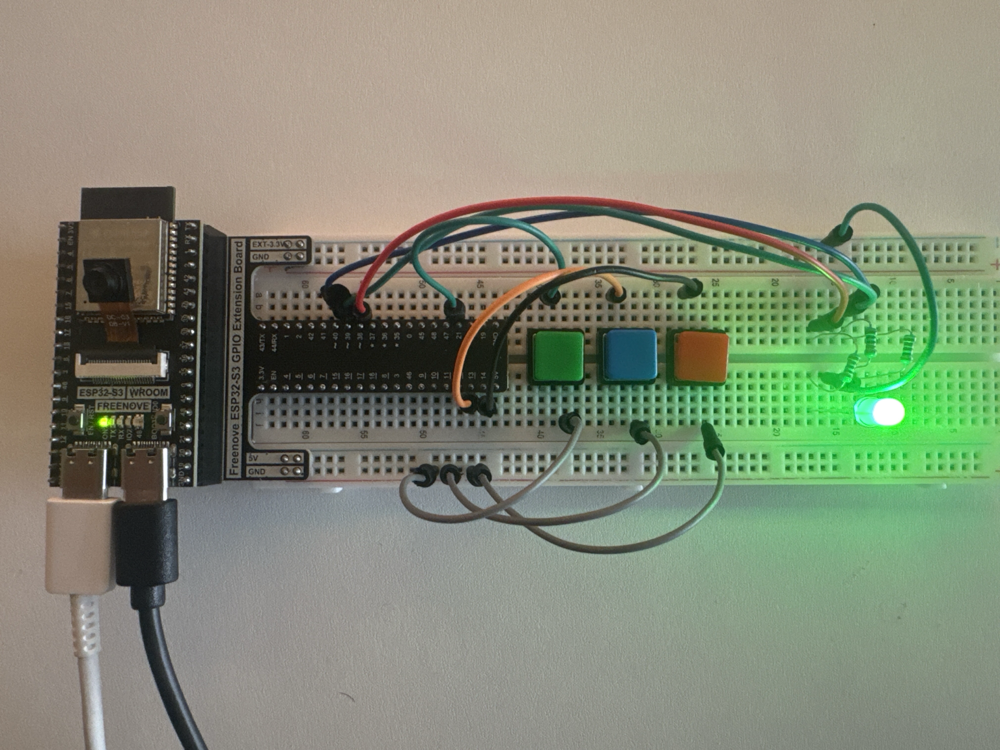

# ESP32-S3 USB Productivity Macro Pad

A programmable USB macro pad built with an ESP32-S3 that provides shortcuts for general computer use, coding, and Arduino development.

The ESP32-S3 uses its native USB interface to act as a USB HID keyboard and consumer control device. Three physical buttons provide different actions depending on the selected profile, while an RGB LED indicates the currently active profile.



## Features

- Native USB HID keyboard support
- USB media controls
- Three physical macro buttons
- Three productivity profiles with nine total actions
- Long-press profile switching
- RGB LED profile indication
- Non-blocking button debouncing using `millis()`
- Persistent profile storage using ESP32 NVS
- Modular C++ firmware architecture

## Profiles

### General — Green

| Button   | Action             |
| -------- | ------------------ |
| Button 1 | Play / Pause       |
| Button 2 | Windows Screenshot |
| Button 3 | Lock PC            |

### Coding — Blue

| Button   | Action                  |
| -------- | ----------------------- |
| Button 1 | Toggle VS Code Terminal |
| Button 2 | Toggle Comment          |
| Button 3 | Find in Files           |

### Arduino — Red

| Button   | Action              |
| -------- | ------------------- |
| Button 1 | Verify / Compile    |
| Button 2 | Upload              |
| Button 3 | Open Serial Monitor |

Holding Button 1 for 1.5 seconds cycles between the three profiles.

## Hardware

- ESP32-S3 development board
- 3 push buttons
- Common-anode RGB LED
- 3 × 220 Ω resistors
- Breadboard
- Jumper wires
- USB-C cables

## Pin Configuration

| Component | ESP32-S3 GPIO |
| --------- | ------------- |
| Button 1  | GPIO 21       |
| Button 2  | GPIO 13       |
| Button 3  | GPIO 14       |
| RGB Red   | GPIO 38       |
| RGB Green | GPIO 39       |
| RGB Blue  | GPIO 40       |

The buttons use the ESP32's internal pull-up resistors and connect the GPIO pins to ground when pressed.

## Firmware Architecture

The firmware is separated into several modules:

```text
sketch/
├── sketch.ino
├── buttons.h
├── buttons.cpp
├── actions.h
├── actions.cpp
├── profiles.h
└── profiles.cpp
```

### `sketch.ino`

Contains the main program initialization and event loop.

### `buttons`

Handles GPIO button input and software debouncing.

### `actions`

Handles USB HID keyboard shortcuts and consumer/media controls.

### `profiles`

Handles profile selection, button mappings, RGB status indication, and persistent profile storage.

## Button Handling

Button inputs are debounced without blocking the main program using `millis()`.

Button 1 also supports short-press and long-press detection. A short press executes the current profile's Button 1 action, while a 1.5-second hold changes profiles.

## Persistent Storage

The currently selected profile is stored using the ESP32 `Preferences` library and Non-Volatile Storage (NVS).

When the device loses power and is connected again, it restores the previously selected profile instead of always returning to the default profile.

## USB HID

The ESP32-S3 native USB-OTG interface allows the device to identify itself to the computer as a USB HID device.

The firmware uses:

- `USBHIDKeyboard` for keyboard shortcuts
- `USBHIDConsumerControl` for media controls

No additional desktop software is required for the current macro functions.

## Future Improvements

- User-configurable button mappings
- Additional short, long, and double-press actions
- Additional profiles
- Configuration interface
- Custom PCB
- 3D-printed enclosure

## Technologies

- C++
- ESP32-S3
- Arduino Framework
- USB HID
- GPIO
- Non-Volatile Storage (NVS)
- Git / GitHub
